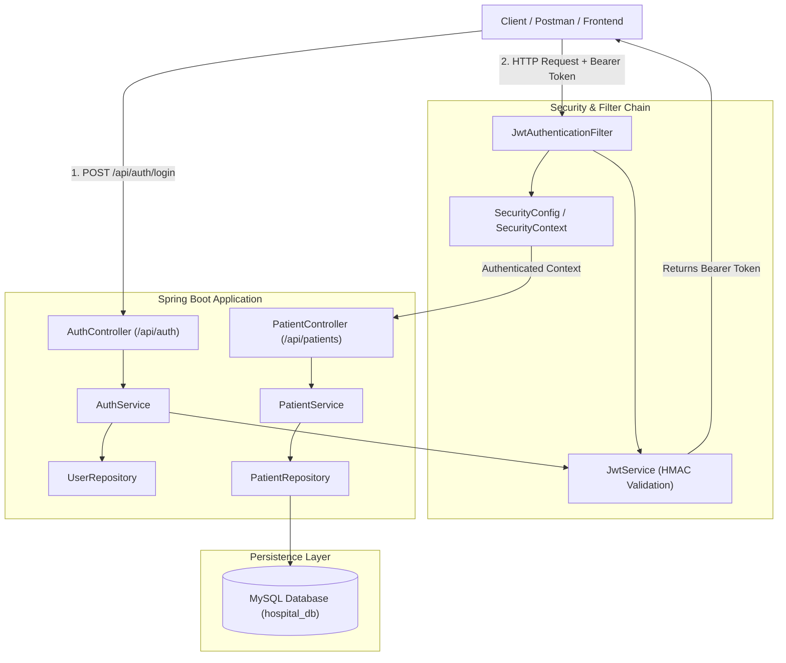
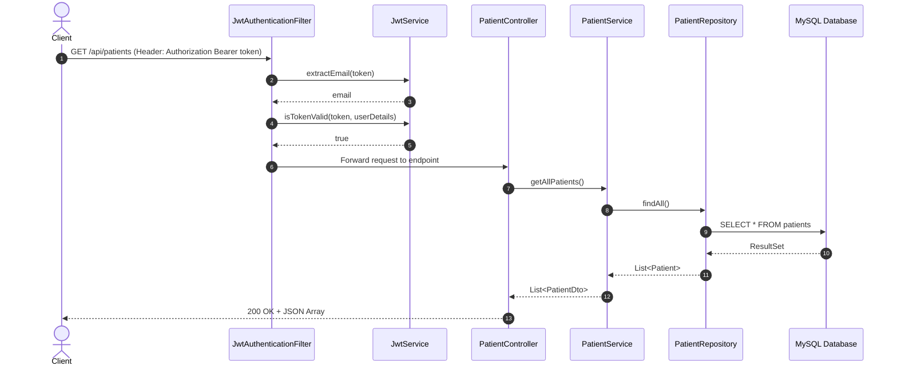

# Hospital Management System - Spring Boot & JWT REST API

A secure, enterprise-ready backend REST API application engineered with Spring Boot, Spring Security, JSON Web Tokens (JWT), Spring Data JPA, and MySQL. This system provides centralized patient registration, healthcare records management, and role-based stateless authentication for clinical and administrative staff.

---

## 1. Project Overview

In healthcare institutions, managing patient records, medical admissions, and clinical histories across legacy or decentralized systems frequently results in data silos, operational latency, and privacy compliance risks. 

The Hospital Management System addresses these challenges by offering a centralized, secure RESTful web service. It enables hospital administrators, doctors, and medical personnel to manage patient records securely. All interactions with sensitive patient data require cryptographically signed JSON Web Tokens (JWT) verified against role-secured endpoints.

The application is structured into two core subsystems:
1. Authentication & Security Subsystem: Handles user onboarding, credential verification, BCrypt password hashing, token issuance, and stateless request filtering via Spring Security.
2. Patient Record Management Subsystem: Provides complete CRUD (Create, Read, Update, Delete) capabilities for patient demographics, medical condition tracking, and contact data.

---

## 2. Problem Statement & Motivation

Traditional healthcare data management systems often suffer from key architectural deficiencies:
* Vulnerable Authentication: Unsecured endpoints or session-based state management that do not scale across distributed services or mobile clinical applications.
* Weak Data Isolation: Direct coupling between database models and API consumers, exposing sensitive fields to unauthorized callers.
* Inconsistent Validation: Lack of strict schema validation on clinical inputs, leading to corrupt or incomplete patient records.
* Unaudited Data Access: Missing centralized access filters to enforce authentication boundaries across private medical records.

This application resolves these issues by implementing stateless token-based authorization via JWT, strict DTO boundaries with Jakarta Bean Validation, and a clean layered architecture that decouples database persistence from API controllers.

---

## 3. Project Objectives

* Architect a production-ready RESTful backend using Java 21 and Spring Boot.
* Implement stateless user authentication using Spring Security and JSON Web Tokens (JJWT).
* Enforce password security using the BCrypt strong hashing algorithm.
* Expose secure CRUD APIs for patient records with input validation.
* Integrate relational database persistence using Spring Data JPA and Hibernate with MySQL.
* Establish clear separation of concerns across Controller, Service, Repository, DTO, and Entity layers.
* Provide automated unit and integration tests using JUnit 5 and Mockito.

---

## 4. Key Features

### User Authentication & Security
* User Registration: Secure onboarding of healthcare staff with validated email format and complex password requirements.
* BCrypt Encryption: Automatic one-way password hashing before persistence in MySQL.
* JWT Token Generation: Digitally signed HMAC-SHA tokens issued upon successful authentication.
* Request Authorization Filter: Custom `JwtAuthenticationFilter` intercepts HTTP requests, parses the `Authorization: Bearer <token>` header, validates token authenticity, and injects user context into Spring Security's SecurityContextHolder.

### Patient Record Management
* Patient Registration: Add new patient admissions with validated fields (name, age, gender, disease, address, phone number).
* Record Retrieval: Query individual patient records by unique identifier or list all registered patients.
* Patient Updates: Modify existing demographic and medical details while preserving record integrity.
* Patient Discharge / Deletion: Remove patient records from active persistence upon discharge.

### Architecture & Quality
* Layered Design: Strict isolation between Presentation (REST Controller), Business Logic (Service), and Data Access (Repository) layers.
* DTO Separation: `PatientDto` and `AuthRequest`/`AuthResponse` decouple public API schemas from internal database tables.
* Centralized Validation: Real-time constraint validation using `@Valid`, `@NotBlank`, `@Email`, and custom checks.

---

## 5. Technology Stack

| Category | Technology | Version | Purpose |
| :--- | :--- | :--- | :--- |
| Programming Language | Java (LTS) | 21 | Core programming language leveraging modern LTS features |
| Framework | Spring Boot | 3.x / 4.x | Rapid application scaffolding and embedded server management |
| Security | Spring Security | 6.x | Security filter chain, authentication manager, password encoder |
| Token Management | JJWT (Java JWT) | 0.12.6 | Generating, signing, and parsing JSON Web Tokens |
| Persistence | Spring Data JPA / Hibernate | 3.x | Object-Relational Mapping (ORM) and repository abstractions |
| Database | MySQL | 8.0+ | Relational data persistence for users and patient records |
| Validation | Jakarta Validation API | 3.0 | Declarative input validation annotations |
| Utilities | Project Lombok | Latest | Boilerplate reduction for entity models and DTOs |
| Build Tool | Apache Maven | 3.9+ | Dependency management, compilation, and packaging |
| Testing | JUnit 5 & Mockito | Latest | Automated unit testing and mock verification |

---

## 6. System Architecture

The following diagram illustrates the request lifecycle through the security filter chain down to the persistence layer:



### Authentication & Token Validation Sequence



---

## 7. Complete Directory Structure

```text
HospitalManagementSystem/
├── .gitattributes
├── .gitignore
├── mvnw
├── mvnw.cmd
├── pom.xml
├── README.md
├── .mvn/
│   └── wrapper/
│       └── maven-wrapper.properties
└── src/
    ├── main/
    │   ├── java/
    │   │   └── com/
    │   │       └── example/
    │   │           └── hms/
    │   │               ├── HospitalManagementSystemApplication.java
    │   │               ├── config/
    │   │               │   ├── JwtAuthenticationFilter.java
    │   │               │   ├── JwtService.java
    │   │               │   └── SecurityConfig.java
    │   │               ├── controller/
    │   │               │   ├── AuthController.java
    │   │               │   └── PatientController.java
    │   │               ├── dto/
    │   │               │   ├── AuthRequest.java
    │   │               │   ├── AuthResponse.java
    │   │               │   └── PatientDto.java
    │   │               ├── entity/
    │   │               │   ├── Patient.java
    │   │               │   ├── Role.java
    │   │               │   └── User.java
    │   │               ├── repository/
    │   │               │   ├── PatientRepository.java
    │   │               │   └── UserRepository.java
    │   │               └── service/
    │   │                   ├── AuthService.java
    │   │                   └── PatientService.java
    │   └── resources/
    │       └── application.properties
    └── test/
        └── java/
            └── com/
                └── example/
                    └── hms/
                        ├── HospitalManagementSystemApplicationTests.java
                        ├── config/
                        │   ├── JwtAuthenticationFilterTest.java
                        │   ├── JwtServiceTest.java
                        │   └── SecurityConfigTest.java
                        ├── controller/
                        │   ├── AuthControllerTest.java
                        │   └── PatientControllerTest.java
                        ├── entity/
                        │   └── EntityTest.java
                        ├── repository/
                        │   ├── PatientRepositoryTest.java
                        │   └── UserRepositoryTest.java
                        └── service/
                            ├── AuthServiceTest.java
                            └── PatientServiceTest.java
```

---

## 8. REST API Reference

Base URL: `http://localhost:8080`

### A. Authentication Endpoints (Public)

#### 1. Register User
* Method: `POST`
* Endpoint: `/api/auth/register`
* Headers: `Content-Type: application/json`
* Request Body:
```json
{
  "email": "doctor@hospital.com",
  "password": "Password@123"
}
```
* Response Status: `201 Created`
* Response Body:
```text
User registered successfully
```

#### 2. User Login
* Method: `POST`
* Endpoint: `/api/auth/login`
* Headers: `Content-Type: application/json`
* Request Body:
```json
{
  "email": "doctor@hospital.com",
  "password": "Password@123"
}
```
* Response Status: `200 OK`
* Response Body:
```json
{
  "token": "eyJhbGciOiJIUzI1NiJ9.eyJzdWIiOiJkb2N0b3JAaG9zcGl0YWwuY29tIiwiZXhwIjoxNjk5OTk5OTk5fQ..."
}
```

---

### B. Patient Management Endpoints (Secured)

All patient endpoints require the `Authorization` header:
`Authorization: Bearer <JWT_TOKEN>`

#### 1. Add New Patient
* Method: `POST`
* Endpoint: `/api/patients`
* Request Body:
```json
{
  "name": "John Doe",
  "age": 42,
  "gender": "Male",
  "disease": "Hypertension",
  "address": "452 Medical Enclave, City Center",
  "phoneNumber": "9876543210"
}
```
* Response Status: `201 Created`
* Response Body:
```json
{
  "id": 1,
  "name": "John Doe",
  "age": 42,
  "gender": "Male",
  "disease": "Hypertension",
  "address": "452 Medical Enclave, City Center",
  "phoneNumber": "9876543210"
}
```

#### 2. Retrieve All Patients
* Method: `GET`
* Endpoint: `/api/patients`
* Response Status: `200 OK`
* Response Body:
```json
[
  {
    "id": 1,
    "name": "John Doe",
    "age": 42,
    "gender": "Male",
    "disease": "Hypertension",
    "address": "452 Medical Enclave, City Center",
    "phoneNumber": "9876543210"
  }
]
```

#### 3. Retrieve Patient by ID
* Method: `GET`
* Endpoint: `/api/patients/{id}`
* Response Status: `200 OK`
* Response Body:
```json
{
  "id": 1,
  "name": "John Doe",
  "age": 42,
  "gender": "Male",
  "disease": "Hypertension",
  "address": "452 Medical Enclave, City Center",
  "phoneNumber": "9876543210"
}
```

#### 4. Update Patient Details
* Method: `PUT`
* Endpoint: `/api/patients/{id}`
* Request Body:
```json
{
  "name": "John Doe",
  "age": 43,
  "gender": "Male",
  "disease": "Hypertension - Controlled",
  "address": "789 Park View Road",
  "phoneNumber": "9876543210"
}
```
* Response Status: `200 OK`
* Response Body:
```json
{
  "id": 1,
  "name": "John Doe",
  "age": 43,
  "gender": "Male",
  "disease": "Hypertension - Controlled",
  "address": "789 Park View Road",
  "phoneNumber": "9876543210"
}
```

#### 5. Delete Patient Record
* Method: `DELETE`
* Endpoint: `/api/patients/{id}`
* Response Status: `200 OK`
* Response Body:
```text
Patient deleted successfully
```

---

## 9. Setup and Installation

### Prerequisites
* Java Development Kit (JDK): Version 21 LTS or compatible.
* MySQL Server: Version 8.0+ running on port 3306.
* Git: Version 2.30+.
* Postman or cURL for endpoint verification.

### Database Setup
Log in to MySQL and create the required schema:
```sql
CREATE DATABASE hospital_db;
```

### Clone and Configure
1. Clone the repository:
```bash
git clone https://github.com/ashishsrivastava1712/HospitalManagementSystem.git
cd HospitalManagementSystem
```

2. Switch to the development branch:
```bash
git checkout develop
```

3. Update database credentials in `src/main/resources/application.properties` if needed:
```properties
spring.datasource.url=jdbc:mysql://localhost:3306/hospital_db
spring.datasource.username=root
spring.datasource.password=your_password
```

### Build the Application
```bash
# On Linux / macOS
./mvnw clean install

# On Windows (PowerShell / Command Prompt)
.\mvnw.cmd clean install
```

### Run the Application
```bash
# On Linux / macOS
./mvnw spring-boot:run

# On Windows
.\mvnw.cmd spring-boot:run
```
The server will initialize on port 8080.

---

## 10. Automated Testing

The codebase includes comprehensive unit tests verifying controller mocking, JWT generation, password encryption, repository persistence, and service logic.

### Run All Tests
```bash
# On Windows
.\mvnw.cmd test

# On Linux / macOS
./mvnw test
```

### Test Suite Structure
* `AuthControllerTest`: Validates registration and login endpoints, checking status codes and response bodies.
* `PatientControllerTest`: Verifies patient CRUD operations using Mockito test doubles.
* `JwtServiceTest`: Tests token generation, subject claim extraction, expiration checking, and signature validation.
* `JwtAuthenticationFilterTest`: Validates authorization header parsing, token validation, and SecurityContext injection.
* `SecurityConfigTest`: Ensures BCrypt password encoder accurately matches plain passwords against hashed representations.
* `PatientServiceTest` and `AuthServiceTest`: Complete business logic verification isolating database calls.

---

## 11. Future Roadmap

1. Role-Based Access Control (RBAC): Differentiate privileges between DOCTOR, NURSE, and ADMIN roles.
2. Appointment Scheduling Module: Associate appointments with doctor schedules and patient records.
3. Billing and Invoicing: Track medical procedures, insurance claims, and payment receipts.
4. OpenAPI 3 / Swagger Documentation: Add interactive documentation via SpringDoc.
5. Audit Logging: Store history of patient record modifications with timestamp and modified-by metadata.

---

## 12. Author Information

Ashish Srivastava  
GitHub: https://github.com/ashishsrivastava1712  
Email: isroasaws@gmail.com  
Repository: https://github.com/ashishsrivastava1712/HospitalManagementSystem
